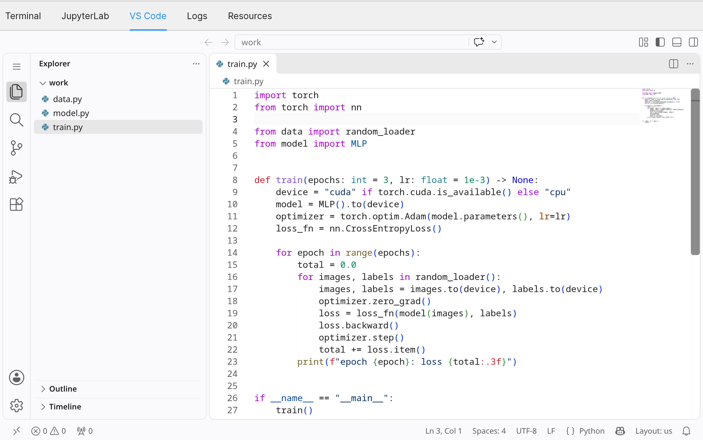
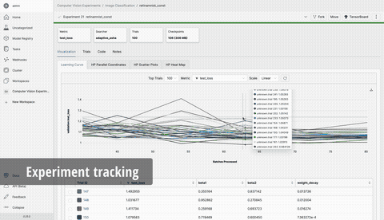
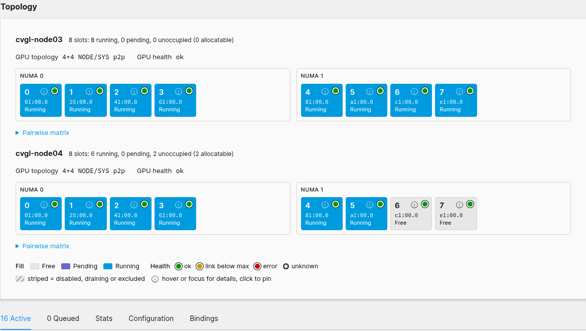
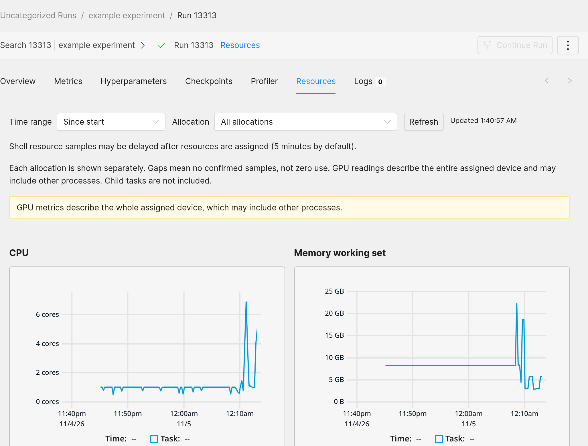

<p align="center"></p>

> **Community fork:** This repository continues open-source Determined development
> and maintenance. See the [installation instructions](#installation),
> [deployment guide](docs/maintenance/distribution.md), and
> [release notes](docs/release-notes.rst).

Determined is an open-source deep learning platform for teams that share GPU clusters. A master
schedules work onto the agents of its resource pools, tracks experiments, checkpoints and logs,
and serves a WebUI with light and dark themes, a REST API and the `det` CLI. One cluster runs
interactive development and batch training side by side, with PyTorch, TensorFlow, DeepSpeed or
any program in a container.

# Interactive

A shell task runs an SSH server; a new shell also runs JupyterLab by default, and VS Code in the
browser when the master serves code-server, in the same container with the same user, files and
GPUs. JupyterLab comes from the task image; the default does not install it. Start a shell with
**Launch Interactive Task** on the **Jobs** page and work on its task page, in the **Terminal**,
**JupyterLab**, **VS Code**, **Logs** and **Resources** tabs. A shell runs until it is killed,
or until it has been idle for the `idle_timeout` its configuration sets.



```bash
det shell start                    # an SSH session and the default services
det task services <shell id>       # the shell's services and their states
det task open <shell id> vscode    # VS Code in the browser
```

# Batch

- **Experiments** with hyperparameter search and distributed training, with metrics,
  checkpoints and a model registry.
- **Commands and TensorBoards** for one-off programs and for viewing training metrics.
- **GPU groups**: `resources.gpu_groups` places named groups of GPUs of exact models on one agent.
- **Resource-pool access control**: pools are public until an administrator restricts them to
  the users granted access.
- **GPU topology placement**: tasks get NUMA-packed or best-connected GPUs, and a pool's topology
  view outlines the GPUs each job holds.
- **Task resource charts**: the CPU, memory and GPU use of each task, read from Prometheus.

<p align="center"></p>





```yaml
resources:
  slots_per_trial: 2
  gpu_groups:
    - {name: simulation, count: 1, models: ["NVIDIA GeForce RTX 4090"]}
    - {name: learner, count: 1, models: ["NVIDIA H100 PCIe"]}
```

```bash
det experiment create experiment.yaml .
```

# Installation

To install this fork's CLI and Python SDK from the repository:

```bash
python -m pip install 'git+https://github.com/WU-CVGL/determined.git@main#subdirectory=harness'
```

Pin the release and its package version:

```bash
VERSION=0.43.1 python -m pip install 'git+https://github.com/WU-CVGL/determined.git@0.43.1#subdirectory=harness'
```

This installs the CLI and SDK only. To run this fork's master and agent, use matching
images and the [fork distribution guide](docs/maintenance/distribution.md).
`det deploy` uses this fork's images under `ghcr.io/wu-cvgl` by default (CLI 0.40.1 and
earlier default to upstream `determinedai`: pass `--image-repo-prefix ghcr.io/wu-cvgl`);
installing the fork CLI alone does not upgrade a cluster.

# Documentation

A master serves the documentation of its version at `/docs` and the REST API reference at
`/docs/rest-api`, for example `http://<master>:8080/docs`. The sources are in [docs/](docs/), and
the [examples folder](examples/) has example models and configurations.

# Contributing

[Contributor's Guide](CONTRIBUTING.md)

# License

[Apache V2](LICENSE)
